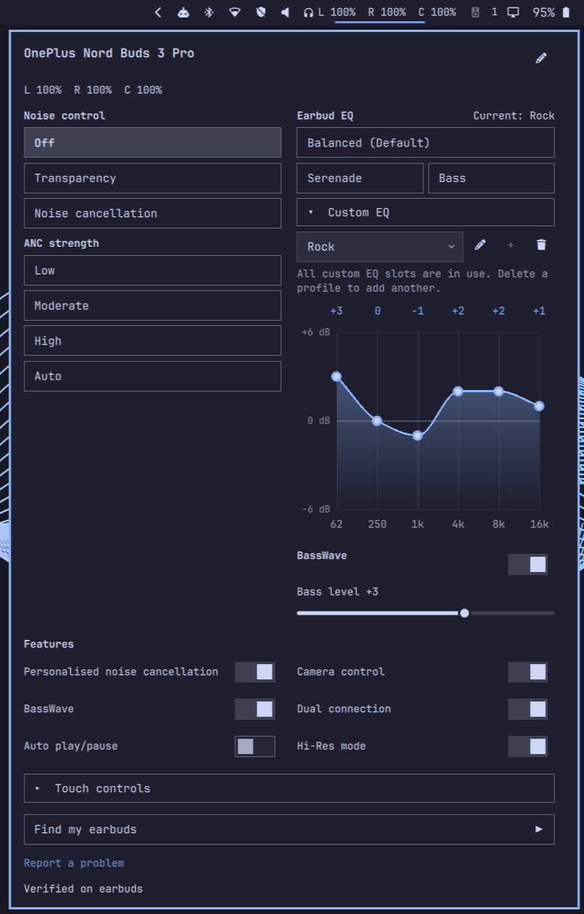

# OnePlus Buds Control for Omarchy

A native Omarchy bar widget and Linux backend for OnePlus earbuds, originally
created by [Gaz](https://github.com/GazzasaurusRex/oneplus-buds-omarchy).
This personal snapshot preserves Jörg Lehmann's owner-tested additions for the
**OnePlus Nord Buds 3 Pro** and makes them available for upstream contributions.
It is independent of OnePlus/OPPO and comes with no ongoing maintenance commitment.

The snapshot identifier is **`nord-buds-3-pro-2026-11-01`**. Package metadata stays
at upstream's `0.1.0`; the dated Git tag identifies this fork's exact source.
Repository URLs below become available when the prepared fork is published.
This fork is not a separate Marketplace listing. The existing
[Marketplace entry](https://plugins.omarchy.org/plugin.html?id=oneplus-buds.control)
installs the original project, not this snapshot.



## What works

- Connection status, component batteries and firmware when the device reports it.
- Model-specific noise control and ANC strengths, with fresh state verification.
- Native earbud EQ presets; device-defined custom curves on supported models.
- A theme-aware panel with two columns when space permits, scrolling on narrow
  screens, and separate collapsible Custom EQ and Touch controls sections.
- A user-controlled diagnostic report saved locally, with no automatic upload.

Additional functions tested on the owner's **Nord Buds 3 Pro**:

| Function | Observed behaviour / limits |
|---|---|
| ANC | Off, Transparency, Noise cancellation; Low, Moderate, High, Auto. Warm changes reuse the session; cold connection setup can still take seconds. |
| Earbud EQ | Balanced (Default), Serenade, Bass. Six-band custom curve editor saves on changed pointer/key release and verifies the result. |
| Custom profiles | Create, rename and delete with confirmation; three slots on the tested firmware. Create/rename restore the previously active profile. |
| BassWave | On/off and a device-defined bass level. |
| Other switches | Personalised noise cancellation, Auto play/pause, Camera control, Dual connection, Hi-Res mode. Set/read-back was tested; actual camera, player and codec behaviour was not measured. |
| Touch controls | Left/right single, double, triple tap and long hold; shared noise-control hold cycle with at least two selected modes. Call gestures retain the device defaults. |
| Find my earbuds | Play/Stop, Stop retained after an uncertain command, best-effort automatic stop after 50 seconds and when the panel closes. Command acceptance was confirmed; there is no reliable in-ear guard. |
| Case battery | Remembers the last valid level across reconnects/restarts. `*` and the tooltip identify a cached sample; old charging flags are not retained. The case reports while the buds are inside the open case and connected. |

Remove the buds from your ears before starting a search sound. Camera control is
for a compatible phone camera; it does not integrate with Linux camera apps.
Dual connection and Hi-Res changes may disconnect/reconnect Bluetooth. Hi-Res
requires a compatible audio host and does not prove a particular Linux codec.
Phone-side OnePlus 3D Audio, Golden Sound and ANC calibration are not implemented.

## Device evidence

| Device | Evidence origin | Recorded firmware | ANC strength labels |
|---|---|---|---|
| OnePlus Buds Pro | Upstream maintainer's historical hardware tests | 541.541.510 | Light, Deep, Smart |
| OnePlus Buds Pro 2 | Upstream maintainer's historical hardware tests | 196.196.101 | Light, Medium, Deep, Smart |
| OnePlus Nord Buds 3 Pro (`064414`) | This fork owner's hardware, October 2026 | 155.155.101 | Low, Moderate, High, Auto |
| Other recognised OnePlus/OPO devices | Experimental; no inherited write permission | Unknown | Not exposed |

The new controls are not assumed to work on other models. The snapshot's complete
unit/UI suites pass, but Pro and Pro 2 have not been physically retested with this
fork. See the [compatibility matrix](docs/devices/compatibility.md) and
[Nord device record](docs/devices/oneplus-nord-buds-3-pro.md).
The current backend uses `verified` for the locally tested Nord write gate; that
is an owner test, not hardware verification by Gaz or Marketplace verification.

## Requirements

The Nord snapshot was exercised with **Omarchy 4.0.6-1**, Quickshell
`0.3.2.r7.g2b4501a-1`, Qt 6.12.0, BlueZ 5.87 and system Python 3.14.8.
It uses Omarchy's `qs.Ui`/`qs.Commons`, including `KeyboardPanel`, `Dropdown`,
`ConfirmDialog`, `PanelSlider` and `ToggleSwitch`. Earlier Omarchy releases were
used by upstream; this snapshot's compatibility with them is not established.
Python 3.11+ is the backend floor; other Python versions were not retested here.
A standalone Quickshell session does not provide the required Omarchy modules.

Runtime dependencies: system Python, `python-dbus`, BlueZ, `bluez-utils` and the
running Omarchy shell. There are no PyPI runtime packages, install hooks,
additional daemon or system audio configuration changes. The read-only preflight
checks basic prerequisites, not shell API compatibility or earbud support:

```bash
python3 scripts/check_dependencies.py
systemctl is-active bluetooth
```

If needed, `omarchy pkg add python-dbus` installs the system binding and may ask
for administrator authorization. Python virtual environments may not see it.

## Install, restore and remove

For this exact snapshot use the [pinned restoration instructions](docs/snapshot.md).
They also cover an existing installation, offline Git-bundle restoration and
rollback. Do not install two copies with the same `oneplus-buds.control` ID.
Ordinary Git installation from the fork follows its current default branch, not
the dated tag; the restoration instructions deliberately use a pinned export.

The original project remains installable through the Marketplace or its own
GitHub URL. Those commands do not install these Nord additions until upstream
accepts them. Local preparation/publication status is in
[publication notes](docs/publication.md).

```bash
omarchy plugin disable oneplus-buds.control
# To remove it later (Omarchy asks for confirmation):
omarchy plugin remove oneplus-buds.control
```

Removing the plugin does not unpair the buds or reset their stored settings.
Keep a backup before replacing a modified installation.

## Use and diagnostics

Pair/connect through Omarchy's Bluetooth panel first. The plugin selects one
connected compatible device; explicit multi-device selection is CLI-only.
Hover the bar icon for batteries and click to open the panel. Controls follow
read-back state; a pending or failed write is not reported as verified.
EQ is stored in the earbuds, independently of Linux's audio route.

The device has one RFCOMM control channel. Disable the plugin before using the
standalone CLI, then re-enable it afterwards:

```bash
omarchy plugin disable oneplus-buds.control
./oneplus-buds status
./oneplus-buds anc status
./oneplus-buds eq list
./oneplus-buds diagnostics --report
omarchy plugin enable oneplus-buds.control --section right
```

`./oneplus-buds --help` lists all commands. `--device ADDRESS` precedes the
command. Do not share Bluetooth addresses printed by `devices` or raw captures.
The panel report uses the existing session, saves to a chosen local `.txt` file,
and omits addresses, device aliases, user/home identity and raw packets.
Review reports before sharing. The panel's issue link still targets upstream;
this preparation does not redirect the runtime workflow or imply that Gaz
supports every fork-specific feature. See [CLI details](docs/backend-cli.md).

If disconnected, check Bluetooth and close competing earbud-control clients.
For ANC tests take the buds out of the case and wear them; the device may reject
changes otherwise. For an absent case battery, put both buds in the open case
while connected and allow the ten-second polling interval. A cached case level
is deliberately marked. See [integration notes](docs/omarchy-integration.md)
for development-only QML caching and lifecycle details.

## Development and contributions

```bash
PYTHONPATH=src python3 -m unittest discover -s tests
python3 tests/run_qml_hover.py
python3 scripts/check_dependencies.py
omarchy plugin validate .
git diff --check
```

Node enables JavaScript model tests; Qt 6 `qmltestrunner` enables the offscreen
UI suite, which uses fake shell services and never contacts earbuds. Full
restoration/packaging checks are recorded in [snapshot verification](docs/snapshot-verification.md).
The Omarchy plugin is distributed as this source tree, not a Python wheel.
Wheel building is a separate path requiring setuptools >=77 and is not validated
by the source-export check.

See [architecture](docs/backend-api.md), [bridge](docs/frontend-bridge.md),
[protocol](docs/protocols/OPOv1.md), [contribution scopes](docs/upstream-contribution.md)
and [CONTRIBUTING](CONTRIBUTING.md). The intent is to offer the measured work
upstream, not to establish a second maintained product.

## License

MIT; original copyright notice retained in [LICENSE](LICENSE).
See [research provenance](docs/research/open-source.md). APKs, decompiled app
sources and the private research workspace are not distributed in this repository.
